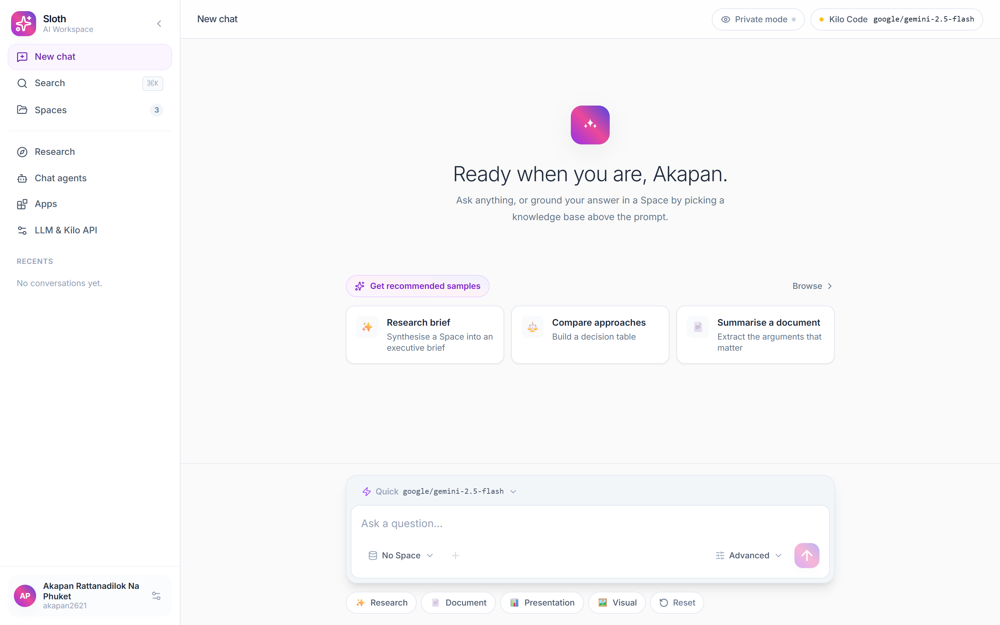
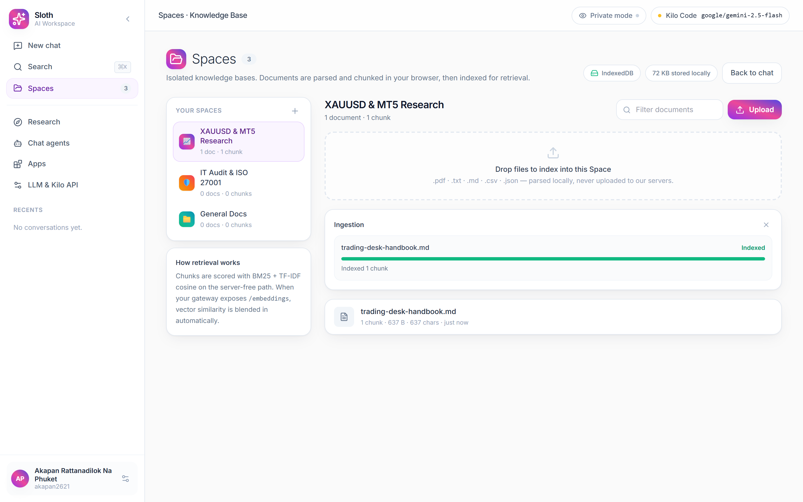
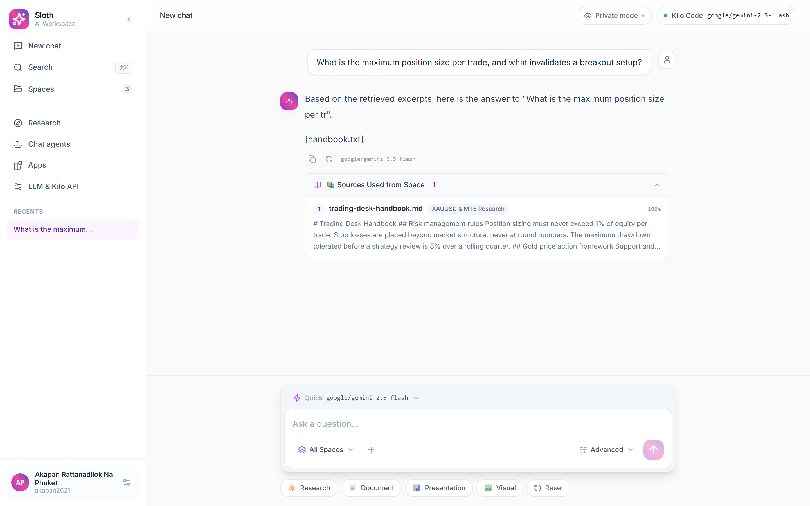

# Sloth · AI Workspace & RAG Knowledge Base

A minimalist, luxury-grade AI workspace with a hybrid RAG knowledge base.
Built for the **Vercel Hobby** and **Supabase free tiers**, powered by the
**Kilo Code AI Gateway** (any OpenAI-compatible endpoint works).



---

## What it does


| Area | Detail |
| --- | --- |
| **Chat** | Streaming responses from the Kilo Code gateway, Markdown + GFM tables, syntax-highlighted code blocks with copy, per-answer citation drawer. |
| **Spaces** | Isolated knowledge bases. Drag-and-drop `.pdf` `.txt` `.md` `.csv` `.json` upload, parsed and chunked **in the browser**, indexed for retrieval. |
| **RAG** | Two retrieval modes. **Mode 1** (zero setup) blends BM25 + TF-IDF cosine + synonym expansion. **Mode 2** adds vector similarity via `pgvector` or local cosine over embeddings. |
| **Providers** | Kilo Code by default, plus Google Gemini, Groq, OpenRouter, or any custom OpenAI-compatible base URL. Model id is a dropdown *and* a free-text field. |
| **Storage** | Works with zero setup using IndexedDB (falling back to `localStorage`). Add Supabase for cloud sync, `pgvector` and the `spaces-files` bucket. |
| **Privacy** | *Private mode* streams straight from the gateway so your API key never reaches the app server (with automatic fallback when CORS blocks it). |

---

## Quick start

```bash
npm install
cp .env.example .env.local   # optional — the app runs without it
npm run dev                  # http://localhost:3000
```

Open the app, click the **Kilo Code** badge in the top-right, paste your API
key, pick a model, then hit **Test**. That is the entire setup.

### Spaces — upload, chunk, index



### Grounded answers — with citations



### Scripts

| Command | Purpose |
| --- | --- |
| `npm run dev` | Development server |
| `npm run build` / `npm start` | Production build and server |
| `npm run lint` | ESLint (`next lint`) |
| `npm run typecheck` | `tsc --noEmit` |
| `npm run verify` | Offline chunking + retrieval test suite (no API key needed) |
| `npm run mock:gateway` | Local OpenAI-compatible mock server on port 4545 |
| `npm run smoke` | Headless-Chrome end-to-end smoke test |

---

## Configuration

Everything is optional. The app is fully functional with no environment
variables at all.

| Variable | Purpose |
| --- | --- |
| `KILO_API_KEY` | Server-side fallback key used when the browser does not send one. |
| `KILO_BASE_URL` | Server-side fallback base URL (default `https://ai-gateway.kilo.ai/api/v1`). |
| `KILO_MODEL_ID` | Server-side fallback model id. |
| `NEXT_PUBLIC_SUPABASE_URL` / `NEXT_PUBLIC_SUPABASE_ANON_KEY` | Enables cloud sync, `pgvector` search and the `spaces-files` bucket. |
| `GEMINI_API_KEY` | Optional — enables `text-embedding-004` for vector mode when the gateway has no `/embeddings` endpoint. |
| `CHAT_TIMEOUT_MS` | Optional — total budget for one streamed answer (default `240000`). |
| `CHAT_FIRST_CHUNK_MS` / `CHAT_CHUNK_MS` | Optional — idle limits once the gateway has started responding (default `60000`). |

Gateways occasionally accept a request and then go silent. The chat route bounds
every request with the timeouts above, and the browser aborts a response that
produces no bytes for 60 seconds, so a stalled model surfaces a retryable notice
instead of an endless spinner.

The user's own key, base URL, model id, temperature, top-K and system prompt
are stored in the browser (`localStorage` / IndexedDB) and applied per request.

---

## Supabase setup (optional)

1. Create a free project at [supabase.com](https://supabase.com).
2. Open **SQL Editor** and run [`supabase/schema.sql`](supabase/schema.sql).
   It creates `spaces`, `documents`, `document_chunks` (with `pgvector` and a
   generated `tsvector`), `chats`, the `match_document_chunks*` retrieval
   functions, RLS policies, and the `spaces-files` storage bucket.
3. Copy the project URL and anon key into `.env.local` and restart.

Without Supabase the same tables are mirrored into IndexedDB, so the retrieval
behaviour is identical.

---

## Architecture

```
app/
  api/chat/route.ts          Streaming endpoint (Vercel AI SDK → gateway)
  api/embeddings/route.ts    Optional vector embeddings
  api/test-connection/route.ts  Gateway reachability + model list
  api/models/route.ts        Model catalogue for the searchable dropdown
  icon.svg, layout.tsx, page.tsx, globals.css
components/
  Workspace.tsx              App shell, view routing, ⌘K palette
  Sidebar.tsx                Collapsible 260px rail, recents, profile
  TopBar.tsx                 LLM badge, private-mode toggle
  ChatView.tsx               Message stream + prompt orchestration
  FloatingPromptBox.tsx      Luxury prompt composer
  MessageBubble.tsx          Markdown answer + sources drawer
  Markdown.tsx               react-markdown + GFM + copyable code blocks
  SpacesManager.tsx          Space CRUD, drag-and-drop upload, progress
  LLMSettingsModal.tsx       Provider / base URL / key / model manager
  SearchModal.tsx            ⌘K search across chats and documents
  SecondaryViews.tsx         Research, Chat agents, Apps
  prompt/                    Model switcher, space picker, advanced popover
  ui/                        Modal, Dropdown primitives
context/
  WorkspaceContext.tsx       Single source of truth for the workspace
lib/
  chunking.ts                Structure-aware 800/150 overlap chunker
  rag.ts                     BM25, TF-IDF cosine, vector cosine, RRF merge
  fileParser.ts              Client-side pdf/csv/json/txt/md extraction
  localDb.ts                 IndexedDB with localStorage fallback
  supabase.ts                Optional cloud mirror + pgvector search
  chatClient.ts              SSE client: server transport + direct transport
  embeddings.ts, types.ts, constants.ts, utils.ts
supabase/schema.sql          Ready-to-run Postgres schema
scripts/                     verify-rag.ts, mock-gateway.mjs, smoke.mjs
```

### Why the browser parses documents

Vercel Hobby functions have a ~4.5 MB request body limit and a short execution
ceiling. Uploading a PDF through the server would break on both. Instead the
file is read with `FileReader` / `File.arrayBuffer()`, extracted with
`pdfjs-dist`, split into 800-character chunks with 150 characters of overlap,
and stored locally. Only the resulting chunks ever reach the server.

### Chunking

`lib/chunking.ts` is structure aware:

1. paragraphs are located with their exact offsets;
2. a short heading is glued to the paragraph that follows it, so a section is
   never separated from its body;
3. blocks are packed up to 800 characters;
4. each chunk after the first starts with a 150-character tail of the previous
   chunk, snapped to a word boundary.

### Retrieval

`lib/rag.ts` implements both modes behind one interface:

- **Lexical** — BM25 (`k1 = 1.5`, `b = 0.75`) over stemmed tokens, blended
  with a TF-IDF cosine pass. The tokenizer handles English (stemmed words)
  and Thai (character bigrams, since Thai writes without word spaces), so
  Thai questions match Thai documents. Queries are expanded with a domain
  synonym table (risk/trading/audit/…). Irrelevant queries return nothing.
- **Vector** — cosine similarity over embeddings, either locally or through
  Supabase `pgvector` (`match_document_chunks`).
- **Fusion** — reciprocal rank fusion merges both rankings.
- **Caching** — the BM25 index is built once per Space and reused until the
  chunk list changes (24k chunks: ~1.4 s to build, ~76 ms per cached query).
  Vector search is skipped entirely when the Space holds no embeddings.
- **Scope inventory** — every RAG message also carries a compact list of the
  files in the selected Space(s) (name, chunk count, size, date), so the
  assistant can answer "what files are in this Space?" even when no excerpt
  matches the query — the norm for numeric datasets (OHLC CSVs) and for
  languages the keyword index cannot bridge.

Retrieved excerpts are injected into the system prompt as a
`<knowledge_base>` block, and the model is instructed to cite the source
document by name. The excerpts that were used are rendered in the
**📚 Sources Used from Space** drawer under the answer.

---

## API

### `POST /api/chat`

```jsonc
{
  "id": "workspace-chat",
  "trigger": "submit-message",
  "messages": [{ "id": "…", "role": "user", "parts": [{ "type": "text", "text": "…" }] }],
  "baseUrl": "https://ai-gateway.kilo.ai/api/v1",
  "apiKey": "…",
  "modelId": "google/gemini-2.5-flash",
  "temperature": 0.7,
  "systemPrompt": "…",
  "ragContextChunks": [
    { "documentName": "handbook.pdf", "spaceName": "XAUUSD & MT5 Research", "content": "…", "score": 0.92 }
  ]
}
```

Responds with an AI SDK UI message stream (`text-delta`, `message-metadata`,
`finish`). Missing key, missing model and empty message lists return `4xx`
JSON with a human-readable message.

> The route uses `createOpenAI({ baseURL, apiKey }).chat(modelId)`. Calling the
> provider directly would use OpenAI's Responses API, which third-party
> OpenAI-compatible gateways do not implement.

### `POST /api/embeddings`

`{ values, baseUrl, apiKey, modelId }` → `{ available, embeddings, modelId, dimensions }`.

The client (`lib/embeddings.ts`) sends texts in batches of 64 with per-request
timeouts, retries transient failures with backoff and halves a batch that
keeps failing, so large files ingest reliably instead of dying on one giant
request. The route distinguishes definitive from transient gateway failures:

- `200 { available: false }` — the gateway has no embedding endpoint; the app
  settles into keyword mode (no failed request logged, no endless retries).
- `502 { available: false, retryable: true }` — timeout / rate limit / 5xx;
  the app retries later and keeps vector mode armed. Saving new credentials
  re-arms vector mode after any permanent fallback.

> **Note on Kilo Code:** the gateway exposes `/v1/embeddings` but rejects the
> calls with *"Add credits to continue"* — embeddings there are paid. Without
> credits the app settles into keyword retrieval (Thai and English). For free
> vector mode, set `GEMINI_API_KEY` in `.env.local`; the route then falls back
> to Google's `text-embedding-004` automatically.

### `POST /api/test-connection`

`{ baseUrl, apiKey }` → `{ ok, message, latencyMs, models }`.

### `POST /api/models`

`{ baseUrl, apiKey }` → `{ ok, models, total, latencyMs }`.

Calls the gateway's `GET /models` and returns its model ids (capped at 500) so
the settings modal can offer a searchable dropdown of what the connected
provider actually serves. The key is optional — gateways like Kilo expose the
catalogue without authentication.

---

## Testing

```bash
npm run verify     # chunking + retrieval assertions, no network
npm run mock:gateway &   # local OpenAI-compatible mock on :4545
npm run smoke      # headless Chrome end-to-end run (11 checks)
npm run e2e        # full journey suite (15 checks)
```

`npm run smoke` drives the real UI: it uploads a document, watches it chunk
and index, saves gateway credentials, sends a message, waits for the streamed
answer and opens the citation drawer — failing on any console error.

`npm run e2e` goes further: navigation across all views, settings + connection
test, document filtering, space CRUD (create / rename / delete), RAG chats
asserted at the request level (with and without context), regenerate, the ⌘K
palette, reload persistence and cleanup.

---

## Deployment

### 1. Push to GitHub

```bash
git init
git add -A
git commit -m "Initial commit"
git remote add origin git@github.com:<you>/sloth.git   # create the repo first
git push -u origin main
```

### 2. Import into Vercel

1. Go to [vercel.com/new](https://vercel.com/new) and import the repo.
2. Leave the build settings as-is (`npm run build` is the default).
3. Add the environment variables you want (all optional — see
   [Configuration](#configuration)). The app is fully usable with no env vars:
   each browser stores its own gateway key.
4. Deploy. Every push to `main` re-deploys automatically.

CLI alternative: `npm i -g vercel && vercel login && vercel --prod`.

The app needs the Node.js runtime for the three API routes; it is
prerendered as a static page with three dynamic API routes.

For the Supabase path, run `supabase/schema.sql` first — the app degrades
gracefully to local storage if the tables are missing.

---

## Notes and limits

- The API key lives in the browser. Treat the deployment as a personal or
  trusted-team instance, or set `KILO_API_KEY` on the server and leave the
  browser key empty.
- Private mode requires the gateway to allow cross-origin browser requests.
  When it does not, the app automatically falls back to the server transport.
- `pgvector` dimensions are fixed at `vector(768)` in the schema, matching
  `text-embedding-004`. Change the column type if you use a 1536-dimension
  model.
